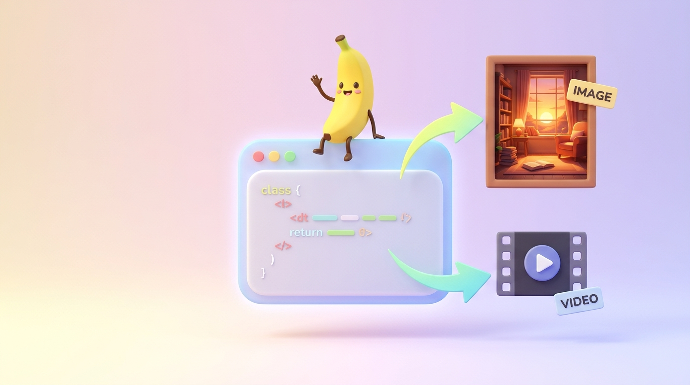

# BananoClaude Images 🍌

[עברית](README.he.md)

**Generate Gemini images (Nano Banana) straight from Claude Code, using the Google AI subscription you already pay for.**

If you have a Google AI Pro / Ultra plan *and* use Claude, there was no clean way to make Gemini images from inside Claude. The Gemini API needs a separate key and per-image billing. This skill fixes that: Claude asks the official Antigravity CLI (`agy`) to draw the image, and the cost comes out of your subscription quota. No API key, no exported tokens, no extra bill.

| Text prompt | Another prompt |
|---|---|
|  |  |

Both images were made from Claude Code with this skill, on Windows 11.

## How it works

```
You -> Claude Code -> /gemini-image -> node script -> official `agy -p` (headless) -> built-in generate_image -> image file in your project
```

- Only the official `agy` binary is launched. The script never reads your Google credentials, never touches cookies or OAuth tokens, and never calls Google servers itself.
- It removes `GEMINI_API_KEY` / `GOOGLE_API_KEY` from the environment so `agy` cannot fall back to paid API-key mode.
- After every image it prints how much quota you have left (5-hour and weekly), and Claude tells you.

## Requirements

- A Google AI Pro or Ultra plan (this is what pays for the images).
- [Node.js](https://nodejs.org) 18+.
- The Antigravity CLI, `agy`, signed in once (steps below).
- Claude Code (also works with Codex, which reads `~/.agents/skills`).

## Install

### Windows (PowerShell)

```powershell
# 1. Install the Antigravity CLI (official Google installer), then open a NEW PowerShell window
irm https://antigravity.google/cli/install.ps1 | iex

# 2. Sign in once. Do it inside a small empty folder, NOT your whole home folder,
#    because agy asks to trust the folder it starts in.
mkdir $HOME\agy-home; cd $HOME\agy-home
agy            # sign in with Google, choose "Yes, I trust this folder", then exit

# 3. Install this skill
git clone https://github.com/Amityst12/BananoClaude-Images.git $HOME\BananoClaude-Images
powershell -ExecutionPolicy Bypass -File $HOME\BananoClaude-Images\install.ps1
```

### macOS / Linux

```bash
# Install agy from https://antigravity.google/download, run `agy` once in an empty folder and sign in.
git clone https://github.com/Amityst12/BananoClaude-Images.git ~/.local/share/BananoClaude-Images
~/.local/share/BananoClaude-Images/install.sh
```

The installer links the skill into `~/.claude/skills` (Claude Code) and `~/.agents/skills` (Codex). An existing skill with the same name is backed up, never deleted. Update later with `git pull`.

Then restart Claude Code.

**Recommended:** in Antigravity settings set **AI Credit Overages** to **Never**, so going over your quota can never spend purchased credits.

## Usage

Just ask Claude:

```
/gemini-image A cobalt-blue glass robot on a warm off-white background, 1:1
/gemini-image Same robot, but riding a bicycle in the rain, 9:16 poster
```

Or call the script directly:

```bash
node ~/.claude/skills/gemini-image/scripts/gemini_image.mjs generate \
  --prompt "A glass robot riding a bicycle on a rainy street, 16:9 landscape" \
  --ref robot.png --out generated-images/robot-bike.png

node ~/.claude/skills/gemini-image/scripts/gemini_image.mjs usage     # remaining quota
```

Output lines: `PATH=`, `SIZE=`, `SOURCE=`, `SECONDS=`, `MARKDOWN=`, `QUOTA_5H=`, `QUOTA_WEEK=`. Add `--no-quota` to skip the quota check, `--dry-run` to see the exact `agy` command without generating.

Tips:
- Put the aspect ratio in the prompt in words ("16:9 landscape", "9:16 vertical").
- Pass reference images with `--ref` (repeatable) to keep a character or style. To edit your last result, use it as `--ref`.
- Each image takes roughly 40-70 seconds and about 1% of a 5-hour window.

## Make Claude use it every time

Claude loads the skill when your request matches its description, but you can make it the default for every image request. Add this to your global `~/.claude/CLAUDE.md` (on Windows: `C:\Users\<you>\.claude\CLAUDE.md`):

```markdown
# Images

When I ask for an image, picture, illustration, avatar or other generated visual, use the `/gemini-image` skill by default.
Do not use other image generators unless I ask for them.
After each image, tell me my remaining quota from the `QUOTA_*` lines.
Diagrams, charts, SVG and UI mockups are not "images" for this rule.
```

Restart Claude Code afterwards. Without this rule it still works, but Claude may pick another image tool if you have several connected.

## Windows notes

Upstream is Mac-first. This fork adds: `install.ps1` (directory junctions, no admin rights), `agy.exe` discovery under `%LOCALAPPDATA%`, Windows path parsing, and image size detection without `sips`. Without `sips`, the file is saved in the format `agy` returns (JPEG). If you ask for `.png`, you still get a `.jpg` and a warning.

## Limits and honest caveats

- Image only. Video (Veo) has no official CLI on a consumer plan, so it is not included.
- Quotas are your plan's. Nothing here bypasses limits or unlocks features your plan lacks.
- Text inside images (signs, labels) can be garbled, and real brand names can appear unprompted. Check before commercial use. Images carry invisible SynthID watermarks.
- Transparent backgrounds are not supported by the `agy` image tool.
- Tested on Windows 11 with `agy` 1.4.9 and Node 22. The macOS path is upstream's and was not re-tested here.
- This is an unofficial community project, not affiliated with Google or Anthropic. `agy` may change; if it does, the script fails with a clear error.

## Credits and license

Based on [inyounglee-datapopcorn/gemini-media-skill](https://github.com/inyounglee-datapopcorn/gemini-media-skill) (MIT, Inyoung Lee / DataPopcorn), which inspired the `agy` bridge. This fork removes the video part, adds Windows support and quota reporting. MIT, see [LICENSE](LICENSE).
